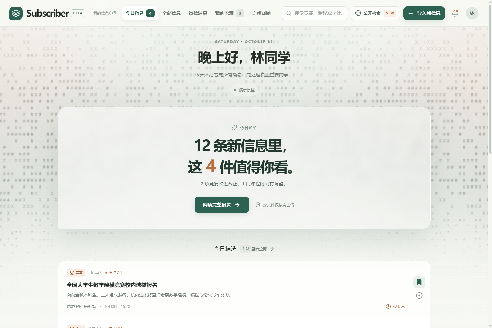

# Subscriber

面向大学生的一站式信息订阅工具，把散落在竞赛官网、校园新闻、课程群和微信群里的信息收拢成**每天一份精选摘要**。

目前是 Web 原型 + Windows 桌面版，核心验证的是「竞赛截止提醒」这一件事——每天只看一份摘要，不用在五个群里翻消息。



## 功能

- **今日精选摘要**：打开即弹出当天摘要，先给结论（「2 项竞赛临近截止，1 门课程时间有调整」），再列条目。
- **信息库**：按竞赛、新闻、课程通知分类筛选，支持搜索与收藏。
- **微信消息（本机优先）**：不读取你的聊天记录。通过系统分享面板或粘贴导入，先把片段存在浏览器 IndexedDB，本机预览后再决定是否按次确认上云分析。
- **我的收藏 / 完成回顾**：完成状态由用户手动勾选，不自动虚构成就。
- **Windows 桌面版**：Electron 免安装包，双击即用。

## 技术栈

| 层 | 选型 |
| --- | --- |
| 框架 | React 19 + TypeScript |
| 构建 | Vite 6 |
| 样式 | Tailwind CSS 4 + 自定义 CSS 变量 |
| 动画 | GSAP + SplitText（逐字入场）、CSS `@keyframes` |
| 背景 | WebGL2 多 Pass 渐变 ASCII（移植自 React Bits GradientASCII） |
| 桌面 | Electron 45（contextIsolation + sandbox，`file://` 加载） |
| 测试 | Playwright |

## 快速开始

```bash
npm install
npm run dev      # http://127.0.0.1:5173
npm run build    # 类型检查 + 生产构建
npm test         # Playwright 端到端测试（7 组）
```

## 桌面版

```bash
npm run desktop           # 构建后以 Electron 直接运行
npm run desktop:portable  # 组装免安装包到 desktop-dist/Subscriber
npm run desktop:verify    # 拉起打包后的 exe 做 13 项端到端检查
```

`desktop:portable` 不使用 electron-builder 的 nsis 目标，而是自行「复制运行时 + 生成 asar + 单文件改名 + 写入图标与版本信息」，全程不做大目录重命名与批量删除。图标由 `build/icon.png` 经 `npm run desktop:icon` 生成七尺寸 `.ico`，再用 `resedit` 写入 PE 资源。

## 项目结构

```
src/
  App.tsx             主界面：顶栏导航、居中的内容层、摘要弹框
  GradientASCII.tsx   全屏 WebGL2 ASCII 背景
  SplitText.tsx       逐字动画标题
  WechatInbox.tsx     微信消息本机优先导入
  localStore.ts       IndexedDB 本地存储
  data.ts             演示数据
electron/             Electron 主进程、打包与验证脚本
tests/                Playwright 用例
```

## 隐私设计

- 无群或账号授权，不读取任何没有权限的内容。
- 公开检索只访问允许使用的公开网页，并保留来源。
- 原始文件默认留在本地，仅在用户主动发起解析时按需上传，并明确删除规则。
- 微信消息不做自动读取，改用系统分享/粘贴入口，先落本机再按次确认。

## 状态说明

这是原型阶段的项目，信息库内为演示数据，尚未接入真实订阅源。云端分析能力需要用户自行完成云服务授权后才会启用。

## 许可

未附许可协议，默认保留所有权利。
